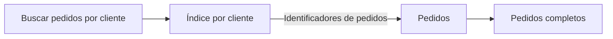

# Patrón Cloud: Index Table

## Introducción

Index Table es un patrón que mantiene una estructura de búsqueda adicional con valores consultables y referencias a los registros originales. Permite acceder a datos mediante un campo distinto de su clave principal, especialmente cuando el almacén ofrece opciones de consulta limitadas o los datos están distribuidos.

Esta demostración usa MongoDB localmente para estudiar el patrón con pedidos y clientes. La tabla de índice se representa mediante una colección separada. El objetivo es comparar el trabajo de una búsqueda por cliente antes y después de construirla.

## Problema y solución

Una tienda almacena pedidos identificados por `_id` y necesita encontrar todos los pedidos de un cliente. Sin un índice sobre `cliente_id`, MongoDB debe examinar los pedidos para identificar los que corresponden al cliente.

La colección `indice_pedidos_cliente` guarda pares de identificadores de cliente y pedido. Una búsqueda consulta primero esta colección y después recupera los pedidos completos por su `_id`.



| Elemento | Función |
|---|---|
| `clientes` | Datos de los clientes de ejemplo |
| `pedidos` | Registros completos de pedidos |
| `indice_pedidos_cliente` | Referencias de cada cliente a sus pedidos |
| Índice de MongoDB sobre `cliente_id` | Facilita la búsqueda de referencias en la colección de índice |
| Índice automático sobre `_id` | Facilita la recuperación de los pedidos completos |

El patrón puede reducir el trabajo de lectura para consultas frecuentes. A cambio, requiere almacenamiento adicional y mantener el índice al crear, modificar o eliminar pedidos. Las dos escrituras pueden fallar por separado y producir inconsistencias, por lo que una aplicación debe definir cómo recuperarse o utilizar transacciones cuando corresponda.

MongoDB también permite crear directamente un índice sobre `pedidos.cliente_id`. Aquí se usa una colección separada para hacer visibles las referencias y su mantenimiento. El resultado compara el patrón con un recorrido sin índice sobre ese campo.

## Casos de aplicación

- Consultar pedidos de un cliente cuando los registros principales se organizan por identificador de pedido.
- Buscar documentos por categoría cuando el almacén principal accede a ellos por identificador.
- Localizar entidades distribuidas a partir de un atributo consultado con frecuencia.

La conveniencia del patrón depende de los accesos disponibles en el almacén, la frecuencia de consultas y el costo de mantener el índice actualizado.

## Demostración práctica

### Objetivo y datos

Comparar la búsqueda de pedidos del cliente `C0001` mediante un recorrido de la colección y mediante una colección de índice. Ambas alternativas deben recuperar los mismos identificadores. Se comparan documentos y claves examinados, además del tiempo informado por MongoDB.

El repositorio contiene `clientes.json` con 1.000 clientes y `pedidos.json` con 10.000 pedidos, diez por cliente. `GenerarDatos.py` permite generar nuevamente los datos en una carpeta que no contenga esos archivos.

### Requisitos

- MongoDB Community Server instalado y en ejecución localmente, con acceso a `localhost:27017`.
- `mongosh` y MongoDB Database Tools, que incluye `mongoimport`, disponibles en el `PATH`.
- CMD de Windows abierto en la carpeta del proyecto.

> Completar tras la prueba: versión de MongoDB, versión de las herramientas y características del equipo.

### Preparación de la base de datos

En CMD, comprueba las herramientas y carga los archivos en una base de datos de demostración:

```cmd
mongosh --version
mongoimport --version
mongoimport --db demo_index_table --collection clientes --file clientes.json --jsonArray
mongoimport --db demo_index_table --collection pedidos --file pedidos.json --jsonArray
mongosh demo_index_table
```

MongoDB crea la base y las colecciones durante la importación. Los comandos de importación están pensados para una primera carga. Si los mismos identificadores ya existen, pueden producir errores por duplicados. Usa una base de demostración vacía o revisa los datos existentes antes de repetir la carga.

Los comandos siguientes se ejecutan en `mongosh`:

```javascript
db.clientes.countDocuments()
db.pedidos.countDocuments()
db.pedidos.findOne()
db.pedidos.getIndexes()
```

Se esperan 1.000 clientes y 10.000 pedidos. Para la comparación inicial comprueba que `pedidos` no tenga un índice sobre `cliente_id`. El índice automático de `_id` debe estar presente.

> **Evidencia pendiente:** agregar captura de la importación, los conteos y los índices existentes.

### Caso 1 — Búsqueda directa

```javascript
db.pedidos.find({ cliente_id: "C0001" }).toArray()
var directa = db.pedidos.find({ cliente_id: "C0001" }).explain("executionStats").executionStats
printjson({ resultados: directa.nReturned, documentos: directa.totalDocsExamined, claves: directa.totalKeysExamined, tiempo_ms: directa.executionTimeMillis })
```

Sin índice sobre `cliente_id`, se espera un recorrido de la colección. El plan completo puede revisarse con `db.pedidos.find({ cliente_id: "C0001" }).explain("executionStats")` y buscar la etapa `COLLSCAN`.

> **Evidencia pendiente:** agregar captura de la consulta y sus estadísticas.

### Caso 2 — Crear y consultar la Index Table

Construye la colección a partir de los pedidos:

```javascript
db.pedidos.aggregate([
  { $project: { _id: 0, cliente_id: 1, pedido_id: "$_id" } },
  { $out: "indice_pedidos_cliente" }
])
db.indice_pedidos_cliente.createIndex({ cliente_id: 1 })
db.indice_pedidos_cliente.find().limit(5).toArray()
```

`$out` reemplaza la colección de destino si ya existe. Tras reconstruirla, verifica que el índice sobre `cliente_id` exista antes de ejecutar la comparación.

Primero se consultan las referencias y luego se recuperan los pedidos:

```javascript
var referencias = db.indice_pedidos_cliente.find(
  { cliente_id: "C0001" }, { _id: 0, pedido_id: 1 }
).toArray()
var ids = referencias.map(referencia => referencia.pedido_id)
var pedidosIndice = db.pedidos.find({ _id: { $in: ids } }).toArray()
printjson(ids)
printjson(pedidosIndice)
```

> **Evidencia pendiente:** agregar captura de la colección de índice, sus índices y los resultados de la consulta.

### Comparación y verificación

Ejecuta las estadísticas de cada etapa de la búsqueda con Index Table:

```javascript
var pasoIndice = db.indice_pedidos_cliente.find(
  { cliente_id: "C0001" }, { _id: 0, pedido_id: 1 }
).explain("executionStats").executionStats
var pasoPedidos = db.pedidos.find(
  { _id: { $in: ids } }
).explain("executionStats").executionStats
printjson({
  sin_index_table: {
    resultados: directa.nReturned,
    documentos: directa.totalDocsExamined,
    claves: directa.totalKeysExamined,
    tiempo_ms: directa.executionTimeMillis
  },
  con_index_table: {
    resultados: pasoPedidos.nReturned,
    documentos: pasoIndice.totalDocsExamined + pasoPedidos.totalDocsExamined,
    claves: pasoIndice.totalKeysExamined + pasoPedidos.totalKeysExamined,
    tiempo_ms: pasoIndice.executionTimeMillis + pasoPedidos.executionTimeMillis
  }
})
```

Comprueba que se obtienen los mismos pedidos:

```javascript
var idsDirectos = db.pedidos.find(
  { cliente_id: "C0001" }, { _id: 1 }
).toArray().map(pedido => pedido._id).sort()
var idsConIndice = pedidosIndice.map(pedido => pedido._id).sort()
print(JSON.stringify(idsDirectos) === JSON.stringify(idsConIndice))
```

El resultado esperado es `true`. Los tiempos de `explain` son estimaciones de ejecución de cada consulta y su suma no incluye el tiempo completo de una aplicación. La caché y el equipo influyen en los resultados. La suma de documentos y claves examinados incluye ambas etapas de la consulta con Index Table.

| Medida | Búsqueda directa | Con Index Table |
|---|---:|---:|
| Pedidos devueltos | Pendiente | Pendiente |
| Documentos examinados | Pendiente | Pendiente |
| Claves examinadas | Pendiente | Pendiente |
| Tiempo informado por MongoDB (ms) | Pendiente | Pendiente |

> **Evidencia pendiente:** agregar capturas de las estadísticas y la verificación de igualdad. Describir las condiciones y observaciones de la ejecución.

### Caso 3 — Mantenimiento del índice

En una base de demostración, agrega un pedido y su referencia:

```javascript
db.pedidos.insertOne({ _id: "P010001", cliente_id: "C0001", producto: "Producto de prueba", total: 100 })
db.indice_pedidos_cliente.insertOne({ cliente_id: "C0001", pedido_id: "P010001" })
db.pedidos.findOne({ _id: "P010001" })
db.indice_pedidos_cliente.findOne({ pedido_id: "P010001" })
```

El ejemplo usa dos escrituras independientes. Si solo una tiene éxito, los datos y el índice quedan desincronizados. También es necesario actualizar el índice si cambia el cliente de un pedido.

Para retirar el dato de prueba:

```javascript
db.pedidos.deleteOne({ _id: "P010001" })
db.indice_pedidos_cliente.deleteOne({ pedido_id: "P010001" })
```

> **Evidencia pendiente:** agregar capturas de la inserción, la comprobación y la eliminación. Explicar cómo se mantendría la consistencia en una aplicación.

## Resultados y conclusiones

> **Pendiente:** interpretar las estadísticas medidas, comparar los resultados de ambas búsquedas y comentar los costos de mantener la colección de índice. Completar con las conclusiones de la ejecución real.

## Referencias

- [Microsoft Azure Architecture Center — Index Table pattern](https://learn.microsoft.com/en-us/azure/architecture/patterns/index-table)
- [MongoDB — Explain Results](https://www.mongodb.com/docs/manual/reference/explain-results/)
- [MongoDB — mongoimport](https://www.mongodb.com/docs/database-tools/mongoimport/)

> **Video de demostración:** pendiente de añadir el enlace.
